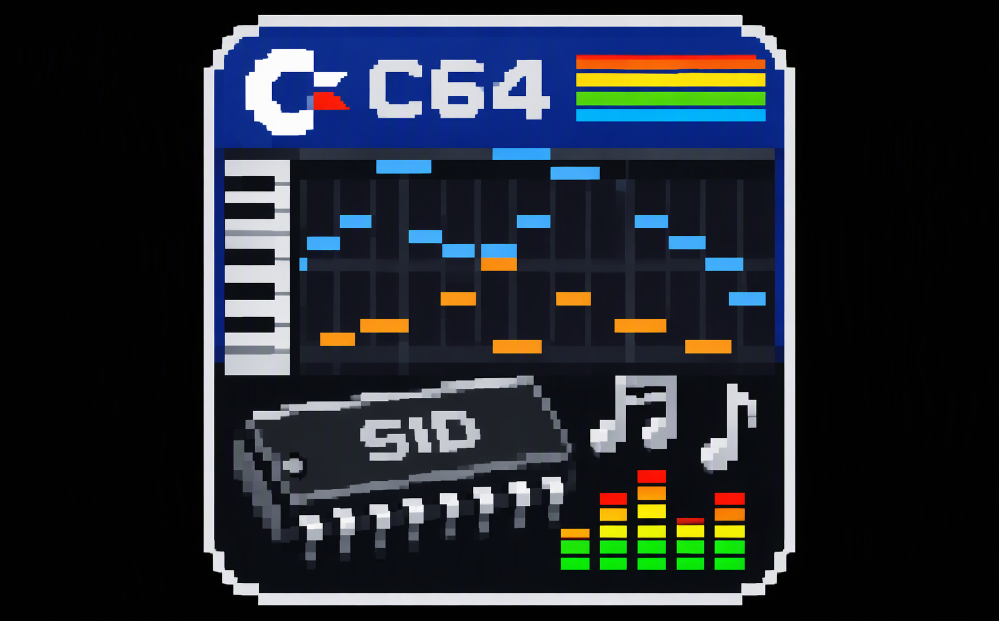

  

<h1 align="center">SID DAW 64</h1>

  <b>A DAW-style editor for the Commodore 64 SID chip</b>

  
  
  
  

---

## Download

Pre-built Windows 64-bit binaries are available on the **[Releases page](https://github.com/MKLIUKANG1/sid-daw-64/releases/latest)**.

Unpack the ZIP and run `SidDAW.exe`. No installation required.

---

## Features

### Import / Export
- **Import MIDI** (`.mid`) with channel selection dialog
  - Assign each MIDI channel to a SID voice
  - Choose single pattern or separate pattern per channel
  - Drum channel (Ch 10) auto-uses Noise waveform
  - Auto-create instruments from GM Program Change (128 presets)
- **Import SID** (`.sid`) — full 6502 emulation in-process, no VICE required
  - PSID and RSID support (with ROM-less fallback)
  - CIA #1 timer emulation for tick-driven players
  - Raster line ($D012) and IRQ flag simulation
  - Automatic init fallback (initAddress=0 → loadAddress)
- **Export WAV** — offline render via `reSIDfp`
- **Export SID** — PSID file with 6502 player assembled by `64tass`
- **Live MIDI recording** from external keyboard via RtMidi

### Raw SID Playback (bit-exact)
- **Play Raw SID** reproduces original register stream 1:1
- **Hybrid mode**: after SID import, Play uses Raw by default
- As soon as you edit notes → switches to notation automatically
- Compare: **Play Raw SID** (exact original) vs **Play** (editable notation)

### Instruments
- Named instruments independent from patterns
- Drag instrument from dock directly onto a note
- `F` key or middle-click on notes opens **Note Properties** dialog
- V / P / D / A mini-preview buttons in instrument list
- Double-click instrument → opens editor panel (FamiStudio-style)
- 30 built-in presets: Bass / Lead / Pad / Pluck / Keys / Drum
- Envelope shape presets: Flat / Ramp+ / Ramp- / Tri / Sine / Pulse

### Envelope Editor
Four hand-drawn envelopes per instrument, all active simultaneously:

| Envelope | Range | Description |
|----------|-------|-------------|
| **Volume** | 0..15 | Note volume |
| **Pitch**  | 0..15 | Bipolar semitone shift (center 8 = no shift) |
| **Duty**   | 0..15 | Bipolar pulse width (center 8 = 50%) |
| **Arp**    | 0..15 | Semitone offset for arpeggios |

Adjustable speed (1..16 points per tick), per-track Clear button.
Pitch envelope has **Absolute / Relative** mode toggle.

### Drum Mode
- Step sequencer with fixed drum rows (Kick, Snare, Hi-Hat, Tom, Crash, ...)
- Per-drum instrument assignment
- Auto-created from MIDI Ch 10 imports
- Drum Kit Editor (Tools → Drum Kit Editor)

### Composition
- **Arrangement / Playlist** — place clips on tracks, resize, drag, delete
- **Piano Roll** — draw, drag, resize, rubber-band select notes
- Note preview inside clips (color = instrument)
- Retro-trigger marker (yellow dot at note end)
- **Undo / Redo** for every edit
- **Per-voice mixer** (volume, pan, solo/mute) + master volume

### Global SID Filter
- Cutoff / resonance / mode / volume extracted from SID import
- Applied to ArrangementPlayer and PatternPlayer
- Saved with the project

### Editing shortcuts

| Action | Key |
|--------|-----|
| Select all notes | `Ctrl+A` |
| Rubber-band select | `Shift` + drag |
| Delete selection | `Delete` |
| Copy / Paste / Cut | `Ctrl+C` / `Ctrl+V` / `Ctrl+X` |
| Quantize to 1/4 | `Q` |
| Quantize to 1/8 | `W` |
| Move (semitone / tick) | Arrow keys |
| Move (octave / quarter) | `Shift` + arrows |
| Note properties | `F` |
| Envelope tabs | `1` `2` `3` `4` |
| Pan view | Middle mouse button |
| Zoom | `Ctrl` + mouse wheel |
| Undo / Redo | `Ctrl+Z` / `Ctrl+Y` |

### Themes
- **Dark** (default), **Light**, **Midnight**, **Solarized**
- Persisted via `QSettings`

### Localization
- English, Russian, Chinese, Portuguese (BR)
- Selected in Language menu, saved via `QSettings`

### Projects
- **Save / load** projects as `.siddaw` (JSON)
- Voice presets as `.json`
- Last-used folder remembered across sessions

---

## Building on Windows (MSYS2 MINGW64)

### Install dependencies
pacman -S --needed base-devel mingw-w64-x86_64-toolchain ^
mingw-w64-x86_64-cmake mingw-w64-x86_64-ninja ^
mingw-w64-x86_64-qt6-base mingw-w64-x86_64-qt6-multimedia ^
mingw-w64-x86_64-rtmidi mingw-w64-x86_64-libresidfp

pacman -S --needed mingw-w64-ucrt-x86_64-64tass
ln -sf /ucrt64/bin/64tass.exe /mingw64/bin/64tass.exe

text

### Build
mkdir -p build && cd build
cmake -G Ninja .. -DCMAKE_BUILD_TYPE=Release -DCMAKE_PREFIX_PATH=/mingw64
cmake --build .

text

### Run
cd build
windeployqt --no-translations SidDAW.exe
./SidDAW.exe

text

If the app complains about missing DLLs, copy them recursively with `ldd` (see `deploy_all.sh` in previous releases, or use `windeployqt` and manually copy `libresidfp-0.dll`, `librtmidi-7.dll`, `libgcc_s_seh-1.dll`, `libstdc++-6.dll`, `libwinpthread-1.dll`).

---

## Architecture

| Module | Purpose |
|--------|---------|
| `src/Model.h` | Data model (Note, VoiceParams, Instrument, Pattern, Clip, Project, SidGlobal) |
| `src/SidEngine` | reSIDfp wrapper with DC blocker and SID filter control |
| `src/ArrangementPlayer` | Real-time playback across clips |
| `src/PatternPlayer` | Offline render for WAV export |
| `src/RawSidStream` | Bit-exact replay of SID register stream |
| `src/RawSidDevice` | QIODevice feeding RawSidStream to QAudioSink |
| `src/SidAudioDevice` | Bridges player to QAudioSink |
| `src/Cpu6502` | Minimal 6502 emulator for SID import |
| `src/SidImporter` | PSID/RSID parser + CIA + register capture |
| `src/SidExporter` | PSID writer (envelopes + filter state) |
| `src/MainWindow` | Main window, menus, toolbars, wiring |
| `src/PianoRollWidget` | Piano roll editor (selection, copy/paste, quantize) |
| `src/ArrangementWidget` | Timeline with clips and preview |
| `src/DrumEditorWidget` | Step sequencer for drum patterns |
| `src/DrumEditorDialog` | Drum kit editor |
| `src/VoicePanelWidget` | Voice params UI (Sliders + 4 envelope tabs) |
| `src/EnvelopeEditorWidget` | Drawable envelope editor |
| `src/EnvelopePresets` | Built-in + user envelope shape presets |
| `src/InstrumentEditorPanel` | Dock panel for instrument editing |
| `src/InstrumentListWidget` | Drag source + V/P/D/A preview buttons |
| `src/InstrumentPresets` | 30 built-in + user instrument presets |
| `src/NotePropertiesDialog` | Per-note editing (instrument, voice, pitch, length) |
| `src/PreviewPlayer` | Short note preview with current parameters |
| `src/ThemeManager` | Theme system with 4 palettes |
| `src/LanguageManager` | Localization (EN/RU/ZH/PT-BR) |
| `src/Commands.h` | QUndoCommand subclasses for all edits |
| `src/MidiImporter` | `.mid` parser |
| `src/MidiImportDialog` | Channel selection dialog |
| `src/MidiPresetManager` | 128 GM preset mapping |
| `src/MidiRecorder` | Live MIDI capture via RtMidi |
| `src/ProjectIO` | Project save/load (`.siddaw`) |
| `src/VoicePresetIO` | Voice preset save/load |
| `src/WavExporter` | Offline WAV render |
| `src/WaveformPreview` | Small waveform preview widget |
| `player.asm` | 6502 SID player routine (assembled by 64tass) |
| `icon.rc` | Windows `.exe` icon resource |
| `resources.qrc` | Qt resource bundle (icon) |

---

## License

MIT — see [LICENSE](LICENSE).

---

## Author

**MKLIUKANG1** — [github.com/MKLIUKANG1](https://github.com/MKLIUKANG1)

---

  <i>Built with love for the Commodore 64 scene</i>

